# 🧪 Pruebas unitarias y GitHub Actions

Este proyecto desarrolla de manera integrada las dos actividades del taller:
**Actividad 1 — Pruebas unitarias** y **Actividad 2 — GitHub Actions**.
Se implementa una mini API REST con FastAPI para realizar operaciones de
preprocesamiento de datos, se comprueba su comportamiento con `pytest` y se
automatiza la validación y publicación mediante Docker y GitHub Actions.

El mismo código fuente se utiliza en ambas actividades. Primero se desarrolla
y prueba localmente la aplicación; después se incorpora a un flujo CI/CD que
valida cada Pull Request y publica una imagen en Docker Hub cuando los tests
pasan en la rama `main`.

## 📦 Estructura del repositorio

```text
unit-testing-ci/
├── app/
│   ├── __init__.py
│   ├── main.py                       # Endpoints FastAPI
│   └── preprocessing.py              # Funciones de preprocesamiento
├── tests/
│   ├── __init__.py
│   ├── test_preprocessing.py         # Pruebas unitarias
│   └── test_api.py                   # Pruebas HTTP con TestClient
├── .github/
│   └── workflows/
│       └── ci.yml                    # Pipeline CI/CD
├── images/                           # Evidencias (agregar capturas)
├── Dockerfile                        # Targets test y runtime
├── pyproject.toml                    # Dependencias y configuración
├── uv.lock                           # Crear con uv lock y versionar
├── .gitignore
├── .dockerignore
└── README.md
```

## 🛠️ Requisitos

- Python 3.12 (versión empleada en el contenedor y en CI).
- [uv](https://docs.astral.sh/uv/) para gestionar las dependencias.
- Docker Engine o Docker Desktop.
- Git y una cuenta de GitHub.
- Cuenta de Docker Hub y un token con permisos de lectura/escritura para
  publicar imágenes.

### Instalar uv

**Linux:**

```bash
curl -LsSf https://astral.sh/uv/install.sh | sh
```

**Windows (PowerShell):**

```powershell
powershell -ExecutionPolicy ByPass -c "irm https://astral.sh/uv/install.ps1 | iex"
```

### Preparar el entorno

Desde la raíz del proyecto:

```bash
uv lock
uv sync
uv run python --version
```

`uv lock` genera o actualiza `uv.lock`. Este archivo debe incorporarse al
repositorio para registrar la resolución de dependencias. `uv sync` crea el
entorno y sincroniza las librerías declaradas en `pyproject.toml`, incluidos
los grupos de desarrollo por defecto.

## 💪 Actividad 1: Desarrollo de la API y pruebas unitarias

### 1. Implementación de las funciones de preprocesamiento

En `app/preprocessing.py` se implementaron tres funciones:

| Función | Entrada | Comportamiento |
| --- | --- | --- |
| `clean_text` | Texto | Normaliza Unicode, convierte a minúsculas y compacta espacios; conserva tildes y puntuación. |
| `validate_range` | Valor, mínimo y máximo | Comprueba tipos numéricos finitos y pertenencia al intervalo cerrado `[minimum, maximum]`. |
| `transform_feature` | Valor, mínimo y máximo | Aplica escalamiento min-max al intervalo `[0, 1]`. |

La transformación min-max se define como:

 $$x_{scaled} = \frac{x - minimum}{maximum - minimum}$$

Se valida que los límites sean distintos para evitar una división por cero.
También se rechazan rangos invertidos y números no finitos.

### 2. Implementación de la API REST

En `app/main.py` se exponen cuatro endpoints:

| Método | Ruta | Descripción |
| --- | --- | --- |
| `GET` | `/health` | Comprobar que la API está disponible. |
| `POST` | `/clean-text` | Normalizar el texto recibido. |
| `POST` | `/validate-range` | Validar el valor numérico respecto de sus límites. |
| `POST` | `/transform-feature` | Escalar un valor mediante min-max. |

Los endpoints usan modelos Pydantic para validar la estructura de la entrada.
Los errores de rango o transformación se devuelven como HTTP `422`.

### 3. Ejecutar la API localmente

```bash
uv run uvicorn app.main:app --reload --host 0.0.0.0 --port 8025
```

Una vez iniciada:

- API: `http://localhost:8025`
- Documentación interactiva: `http://localhost:8025/docs`
- Documentación alternativa: `http://localhost:8025/redoc`

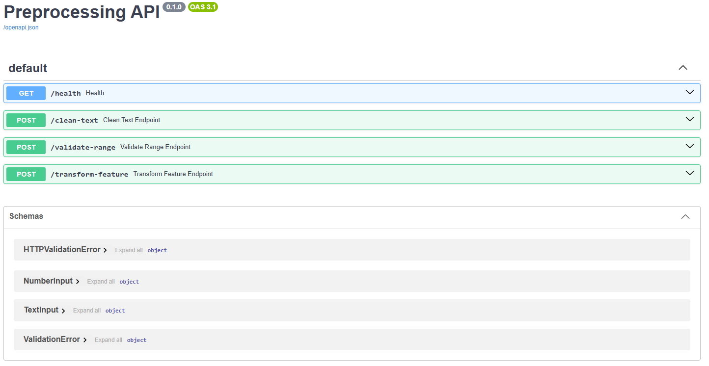

### 4. Probar los endpoints

#### GET /health

```bash
curl http://localhost:8025/health
```

Respuesta esperada:

```json
{"status": "ok"}
```
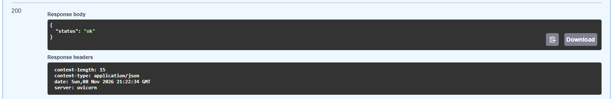

#### POST /clean-text

```bash
curl -X POST http://localhost:8025/clean-text \
  -H 'Content-Type: application/json' \
  -d '{"text":"  HOLA   Mundo "}'
```

Respuesta esperada:

```json
{"result": "hola mundo"}
```

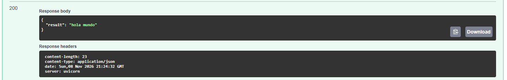

#### POST /validate-range

```bash
curl -X POST http://localhost:8025/validate-range \
  -H 'Content-Type: application/json' \
  -d '{"value":50,"minimum":0,"maximum":100}'
```

Respuesta esperada:

```json
{"result": 50.0}
```

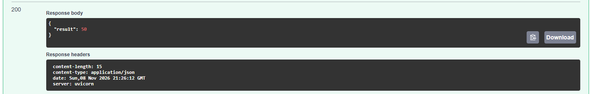

#### POST /transform-feature

```bash
curl -X POST http://localhost:8025/transform-feature \
  -H 'Content-Type: application/json' \
  -d '{"value":25,"minimum":0,"maximum":100}'
```

Respuesta esperada:

```json
{"result": 0.25}
```


### 5. Desarrollar y ejecutar pruebas con pytest

Se prepararon dos módulos de pruebas:

- `tests/test_preprocessing.py`: validación de las funciones puras, incluidos
  límites y errores mediante `pytest.raises`.
- `tests/test_api.py`: pruebas de endpoints utilizando `TestClient`, sin
  levantar un servidor externo.

Las pruebas contemplan entradas normales, textos vacíos, preservación de
tildes, límites inclusivos, rangos inválidos, valores `NaN`, intervalos
sin amplitud y solicitudes HTTP inválidas. La suite original contempla
**17 casos ejecutables** (incluido un test parametrizado con dos valores).

Para ejecutar la suite:

```bash
uv run pytest -v
```

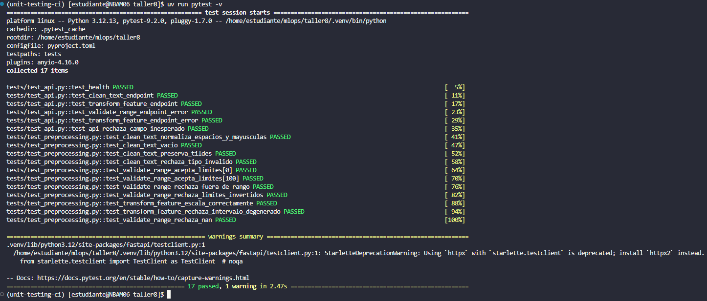

### 6. Comprobar manejo de errores

El requisito de `pytest.raises` se cubre, por ejemplo, verificando que un
valor fuera del rango genere `ValueError`:

```python
with pytest.raises(ValueError, match="fuera del rango"):
    validate_range(101, 0, 100)
```

En la API, una solicitud con `value=101`, `minimum=0`, `maximum=100`
debe responder con código HTTP `422`.

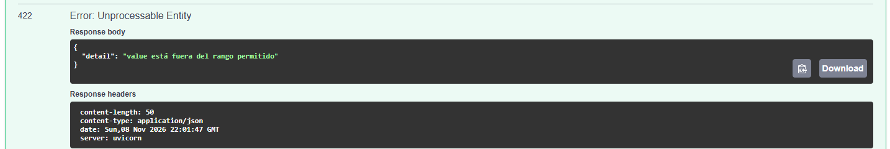

### 7. Ejecutar las pruebas dentro de Docker

El `Dockerfile` define dos etapas relevantes:

| Target | Uso |
| --- | --- |
| `test` | Ejecutar `pytest` automáticamente al iniciar el contenedor. |
| `runtime` | Iniciar la API mediante Uvicorn. |

La etapa final predeterminada es `test`. Para crear la imagen de pruebas:

```bash
docker build -t preprocessing-tests .
docker images
```

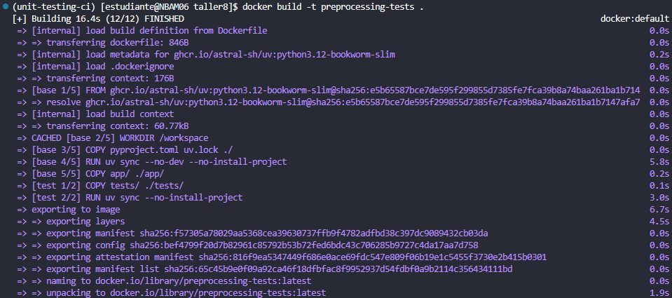

Ejecutar el contenedor:

```bash
docker run --rm preprocessing-tests
```

El contenedor ejecuta `pytest -v` sin intervención manual y termina con
código de salida cero si las pruebas pasan.

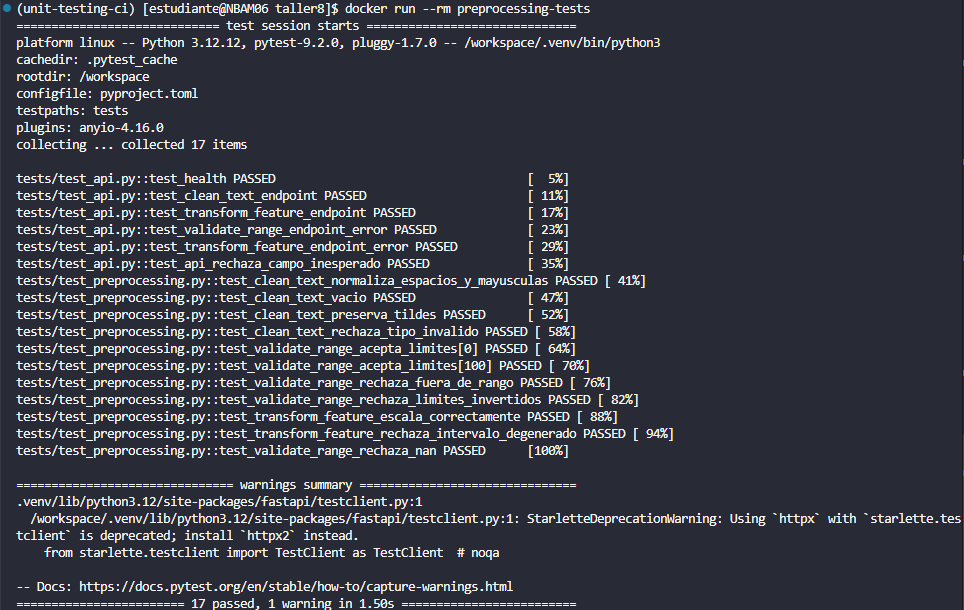

### 8. Desplegar la API en un contenedor

Construir específicamente la etapa `runtime`:

```bash
docker build --target runtime -t preprocessing-api:local .
```

Iniciar la API en el puerto `8025`:

```bash
docker run --rm -p 8025:8025 preprocessing-api:local
```

Abrir `http://localhost:8025/docs` y ejecutar las mismas consultas de la
sección 4. Para detener el servidor, presionar `Ctrl+C`.

## 🚀 Actividad 2: Automatización con GitHub Actions

### 9. Crear y publicar el repositorio en GitHub

Una vez completada la validación local, se incorporó el código a Git para
control de versiones. Para un repositorio nuevo:

```bash
git init
git branch -M main
git add .
git commit -m "feat: add preprocessing API and unit tests"
git remote add origin https://github.com/USUARIO/REPOSITORIO.git
git push -u origin main
```

### 10. Configurar el workflow CI/CD

El archivo `.github/workflows/ci.yml` define los eventos:

- `pull_request` hacia `main`: ejecutar validación automatizada.
- `push` a `main`: ejecutar validación y, si es exitosa, publicar la imagen.

El flujo del pipeline es:

```text
Pull Request hacia main
          │
          ▼
      unit-tests
          │
          ├── Error ──────► PR sin check aprobado
          │
          ▼
      Éxito
          │
          ▼
 Merge permitido si las reglas de main se cumplen
          │
          ▼
      Push a main
          │
          ▼
      unit-tests
          │
          ├── Error ──────► No publicar
          │
          ▼
      Éxito
          │
          ▼
   publish-dockerhub
          │
          ▼
    latest + <sha>
```

El job `unit-tests` instala dependencias mediante `uv`, ejecuta `pytest`
y repite la validación en Docker. El job `publish-dockerhub` depende de
`unit-tests` y se ejecuta únicamente para `push` a `main`.

### 11. Configurar Docker Hub y las variables de GitHub

Primero, crear un token de acceso personal en Docker Hub con permisos para
publicar imágenes. Luego ingresar al repositorio GitHub en:

`Settings > Secrets and variables > Actions`

Configurar:

| Tipo | Nombre | Valor |
| --- | --- | --- |
| Repository secret | `DOCKERHUB_USERNAME` | Usuario de Docker Hub. |
| Repository secret | `DOCKERHUB_TOKEN` | Token personal de Docker Hub. |
| Repository variable | `DOCKERHUB_IMAGE` | `USUARIO/unit-testing-app` (sin tag). |

En el workflow la imagen se identifica mediante la variable de repositorio:

```yaml
env:
  APP_PATH: .
  IMAGE_NAME: ${{ vars.DOCKERHUB_IMAGE }}
```

El valor de `DOCKERHUB_IMAGE` se configura en **Variables**, no en **Secrets**, porque el workflow lo obtiene desde `vars`.

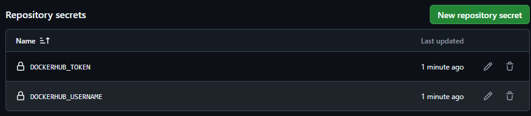

### 12. Verificar la ejecución automática de las pruebas

Al hacer `push` a `main`, GitHub Actions ejecuta el job `unit-tests`.
Para validar el funcionamiento:

1. Abrir la pestaña **Actions** del repositorio.
2. Seleccionar la ejecución correspondiente al commit.
3. Abrir el job `unit-tests`.
4. Verificar que `pytest` y la ejecución en Docker finalicen correctamente.

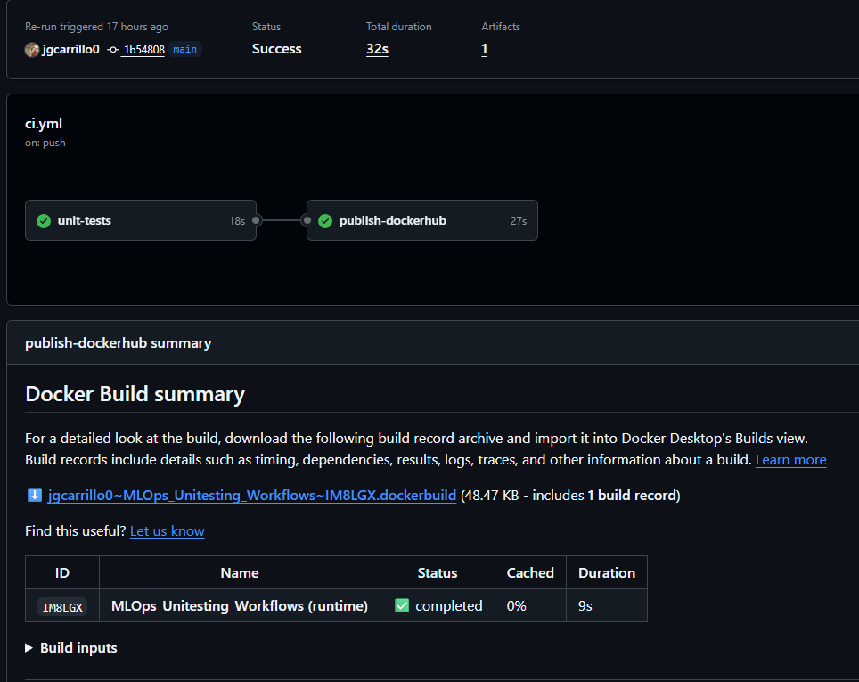

### 13. Publicar automáticamente la imagen en Docker Hub

Cuando las pruebas pasan en un `push` a `main`, se habilita
`publish-dockerhub`. El workflow construye el target `runtime` y publica
la imagen con dos etiquetas:

```text
USUARIO/unit-testing-app:latest
USUARIO/unit-testing-app:<sha-completo-del-commit>
```

`latest` representa la publicación más reciente; el SHA permite identificar
el commit exacto del código que originó la imagen.

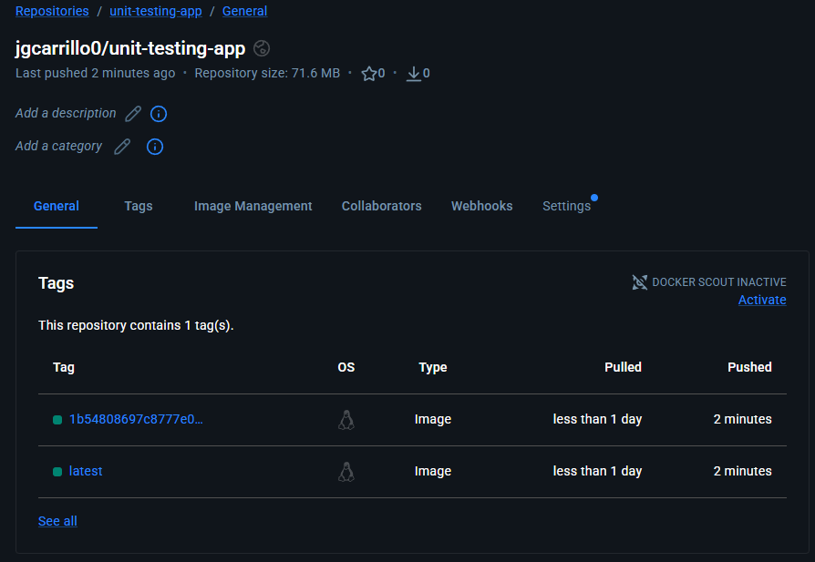

### 14. Proteger la rama main mediante un ruleset

En GitHub ingresar a **Settings > Rules > Rulesets > New branch ruleset**
y establecer:

| Campo / regla | Configuración recomendada |
| --- | --- |
| Ruleset name | `protect-main-ci` |
| Enforcement status | `Active` |
| Bypass list | Vacía, si se busca demostrar el bloqueo |
| Target branches | `main` |
| Restrict deletions | Activado |
| Block force pushes | Activado |
| Require a pull request before merging | Activado |
| Require status checks to pass | Activado |
| Required status check | `unit-tests` |
| Require branches to be up to date | Activado, si está disponible |

El check debe coincidir con el nombre reportado por Actions. La protección
solo es efectiva si el ruleset está **Active** y el plan y la visibilidad
del repositorio permiten aplicar estas reglas.

### 15. Reto: bloquear el merge mediante una prueba fallida

Crear una rama para el experimento:

```bash
git switch main
git pull origin main
git switch -c test/ci-failure
```

Agregar temporalmente a `tests/test_preprocessing.py`:

```python
def test_ci_intentional_failure() -> None:
    """Verifica que el CI rechace una prueba fallida."""
    assert 1 == 2, "Fallo intencional para validar CI"
```

Ejecutar localmente para comprobar el fallo:

```bash
uv run pytest -v
```

Registrar y publicar el cambio:

```bash
git add tests/test_preprocessing.py
git commit -m "test: simulate CI failure"
git push -u origin test/ci-failure
```

Crear un Pull Request con **base** `main` y **compare** `test/ci-failure`.
El job `unit-tests` debe fallar. Si la protección se encuentra aplicada,
GitHub debe impedir el merge.

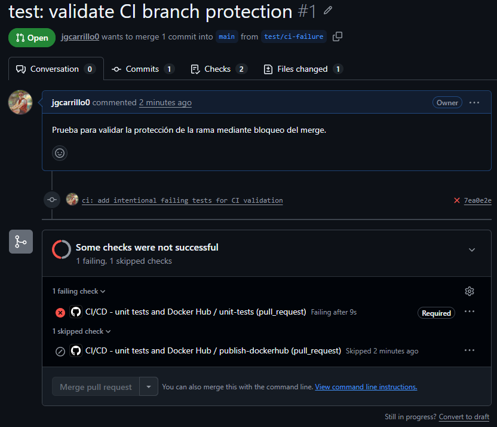

### 16. Corregir la prueba y completar el merge

Eliminar la función temporal `test_ci_intentional_failure` y verificar:

```bash
uv run pytest -v
git add tests/test_preprocessing.py
git commit -m "test: remove intentional CI failure"
git push origin test/ci-failure
```

Tras pasar `unit-tests`, completar el merge del Pull Request desde GitHub.
El nuevo `push` a `main` debe volver a ejecutar la validación y, si es
exitosa, publicar la imagen.

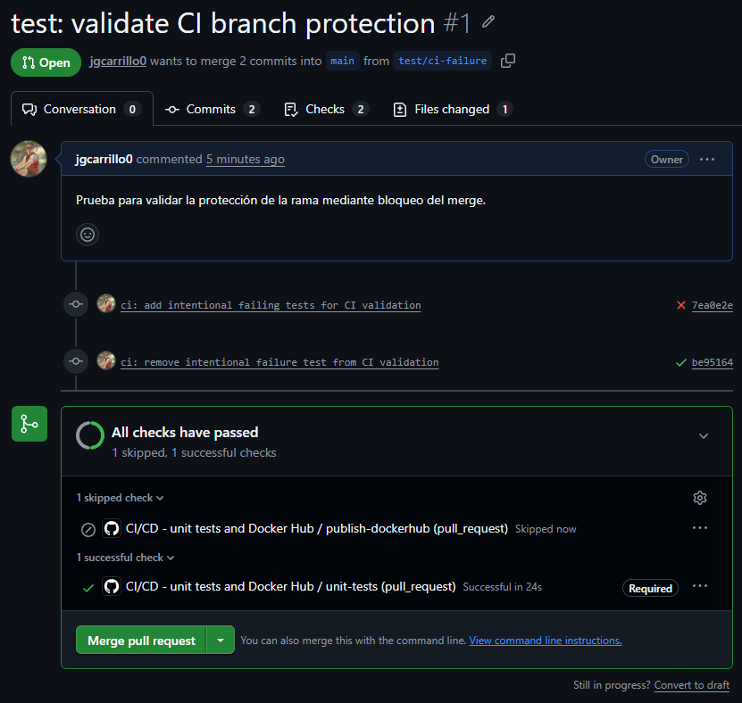

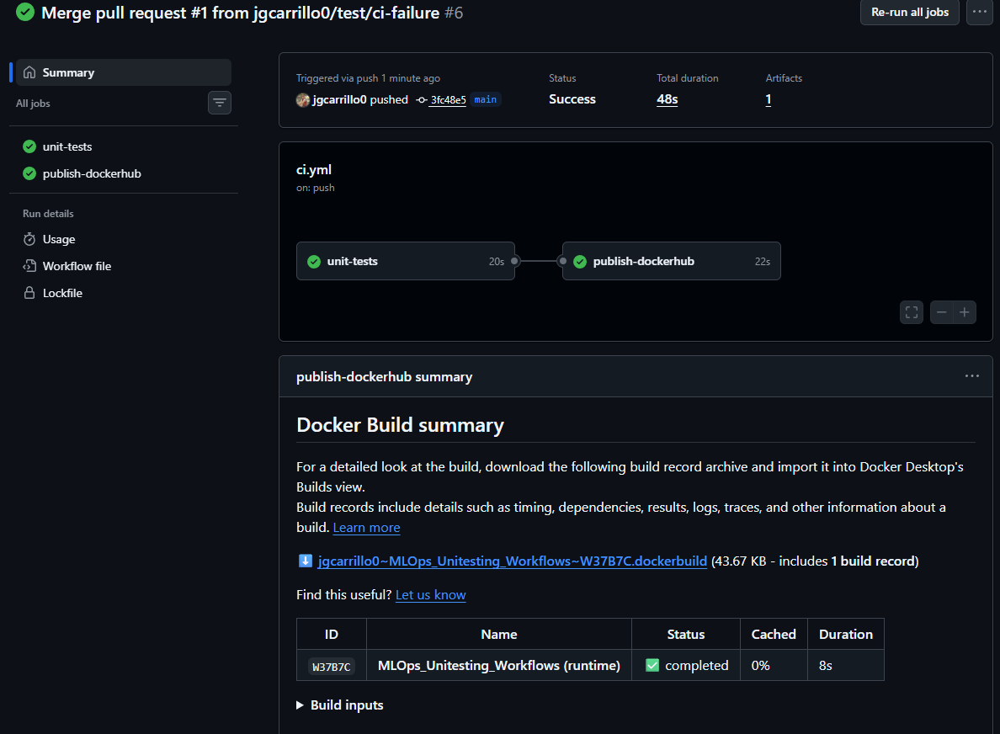
